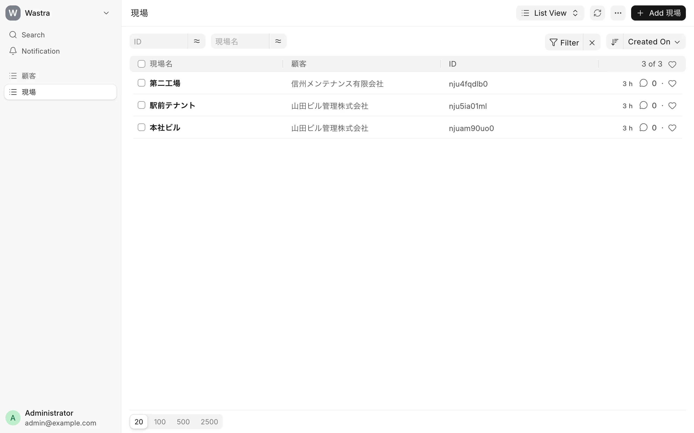
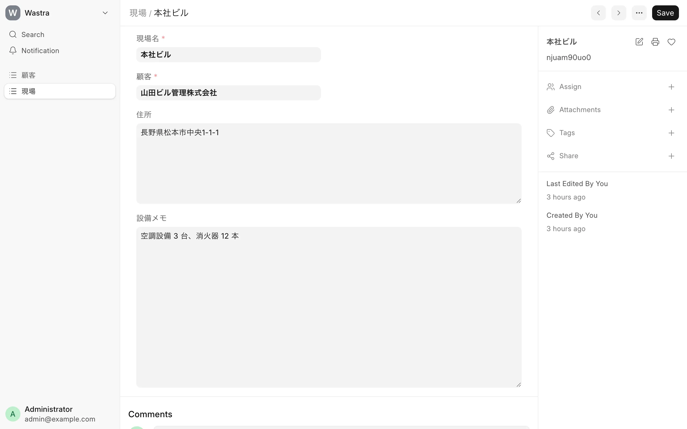

# Wastra

地方の現場業務（清掃、設備点検、保守）向けの業務管理 SaaS です。[Frappe Framework](https://frappe.io/framework) v16 のアプリです。

現場の一覧です。



現場の入力画面です。



開発のルールは [AGENTS.md](AGENTS.md)、設計は [ARCHITECTURE.md](ARCHITECTURE.md) にあります。

## 開発環境を作る

次のものを先に入れます。

- [uv](https://docs.astral.sh/uv/)。Python 3.14 と bench は `make setup` が uv 経由で取得します。
- Node.js 24
- MariaDB のクライアントと開発用ライブラリ。macOS では `brew install mariadb pkg-config` で入ります。Ubuntu では `apt-get install mariadb-client libmariadb-dev pkg-config` で入ります。
- Docker。MariaDB と Redis の起動に使います。

Docker がない環境では、Docker の代わりに MariaDB と Redis のサーバーを入れます。macOS では `brew install mariadb redis`、Ubuntu では `apt-get install mariadb-server redis-server` です。サービスとして起動しておく必要はありません。

リポジトリのルートで実行します。

```bash
make setup
```

初回は Frappe の取得とビルドで数分かかります。`make setup` は MariaDB と Redis を起動し、`.bench/` に bench を作り、サイト `wastra.localhost` に Wastra をインストールします。サイトの言語は日本語、タイムゾーンは Asia/Tokyo、通貨は JPY に設定します。

## Docker のない環境で動かす

クラウドのエージェント環境のように Docker が動かない場所でも、手順は同じ `make setup` です。Docker に接続できないとき、`make setup` は `mariadbd` と `redis-server` をプロジェクト内のプロセスとして起動し、データを `.services/` に置きます。選んだ方式は `.env` の `WASTRA_SERVICES`（`docker` か `local`）に記録します。方式を指定するには、最初の `make setup` の前に環境変数 `WASTRA_SERVICES` を設定します。

bench は root では動きません。root で始まる環境では、先に一般ユーザーを作り、そのユーザーで `uv` を入れてリポジトリを開きます。

環境を再起動してプロセスが止まっても、`make check` と `make start` が先に `make services` を実行して起動し直します。

## 動かす

```bash
make start
```

ブラウザで `http://wastra.localhost:8000` を開きます。ユーザー名は `Administrator` です。パスワードは `.env` の `ADMIN_PASSWORD` です。

## 変更を検査する

```bash
make check
```

lint、型、単体テスト、統合テストをすべて実行します。コミット時には Git フックが `make lint typecheck` を実行します。
